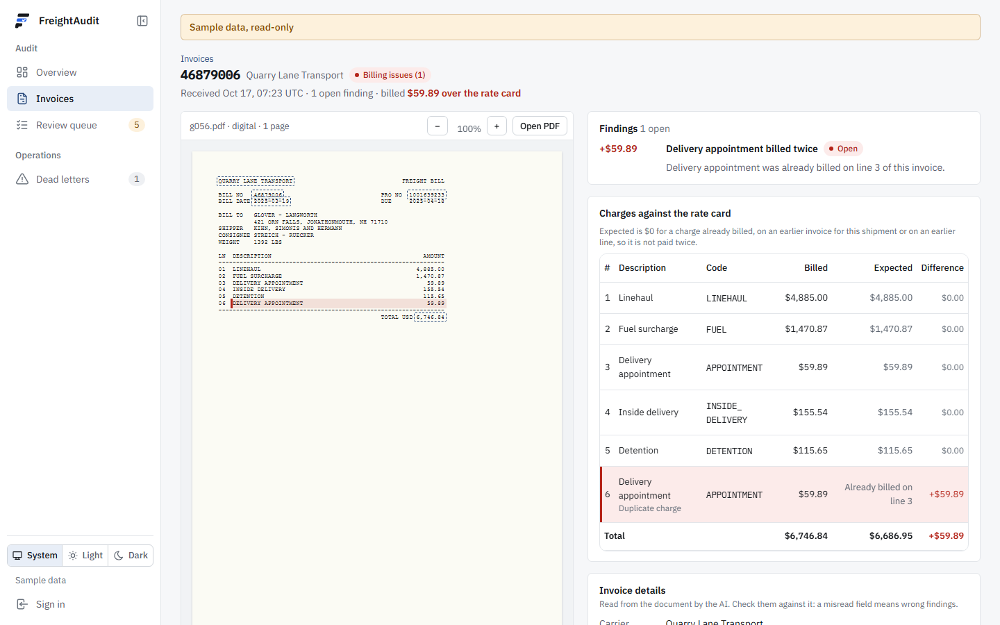

# FreightAudit

Audits carrier freight invoices: an LLM reads each invoice, deterministic code checks every charge against the contract, and a person decides.



**Live demo: https://freightaudit-bay.vercel.app** (the sample data opens without signing in)

- **Reads** invoice PDFs, digital or scanned, one at a time or in batches of up to 500: header fields and every charge.
- **Checks** each charge in code against the carrier's rate card on the ship date and the shipment record from a TMS, and flags overcharges, charges outside the contract, charges billed twice and repeated invoice numbers.
- **Holds** every finding for a reviewer, who approves or disputes it in the web app; the audit trail records who decided what, and when.

The carriers are fictional and every invoice is synthetic.

## Results

<!-- results:start -->
On 98 synthetic invoices with known ground truth (golden set v2); every metric with its 95% interval is in the [eval card](evals/README.md).

- Overcharges caught: **97.4%** with Claude first ([report](evals/reports/2026-11-02-v2-full-claude-first.md)), **94.9%** with the free models only ([report](evals/reports/2026-10-27-v2.md)).
- Clean charges flagged: **0%** with Claude first ([report](evals/reports/2026-11-02-v2-full-claude-first.md)), **0%** with the free models only ([report](evals/reports/2026-10-27-v2.md)).
- Cost per scanned invoice, paid-equivalent: **$0.0105** with Claude first ([report](evals/reports/2026-11-02-v2-full-claude-first.md)), **$0.0020** with the free models only ([report](evals/reports/2026-10-27-v2.md)).
<!-- results:end -->

**Built with** TypeScript, Fastify, GraphQL Yoga, BullMQ on Redis, Postgres with Drizzle, Next.js, Claude Sonnet with free Gemini and Groq models behind it, OpenTelemetry, Playwright and Jest.

## Run it locally

Needs Node 24, pnpm 12 and Docker.

```bash
pnpm install
cp .env.example .env   # set API_KEYS; models stay off until AI_ENABLED=true and their keys are set
docker compose --env-file .env -f infra/docker-compose.yml up -d --wait
pnpm db:migrate && pnpm db:seed --scale=small
pnpm dev               # web on http://127.0.0.1:3000, api on :4000
```

Checks: `pnpm test`, `pnpm lint`, `pnpm typecheck`, `pnpm test:int` and `pnpm e2e` (both need Docker).

## Repository map

- `apps/` the web app (Next.js), the api (Fastify and GraphQL), the worker (BullMQ jobs) and a mock TMS.
- `packages/` shared code: the domain rules and money math, the LLM provider layer, the extraction pipeline, the database, API contracts, settings and telemetry.
- `evals/` the golden invoice sets, the eval harness and every eval report; start at the [eval card](evals/README.md).
- `infra/` Docker Compose for local services and the demo, with the monitoring config.
- `loadtest/` the k6 load test and its results.
- `scripts/` the demo backend's start, stop and backup commands.
- `docs/` third-party notices and screenshots of the app.

## Licence

MIT, in [LICENSE](LICENSE). Outside work used here, and its licences, are in [docs/third-party.md](docs/third-party.md).
