# FreightAudit

FreightAudit audits carrier freight invoices.

- An LLM reads each invoice PDF, digital or scanned: its header fields and every charge. Invoices arrive one at a time or in batches of up to 500 files (`apps/api/src/app.ts`).
- Deterministic code checks every charge against the carrier's rate card in force on the ship date, and against the shipment record synced from a TMS (a mock one here).
- A charge above its contracted rate, a charge the contract does not cover, a charge billed twice and an invoice number its carrier billed before each become a finding.
- A reviewer decides every finding in the web UI; nothing is approved without a reviewer. The audit trail records who did what, and when.

The carriers are fictional, and every invoice is synthetic.

## Live demo

**https://freightaudit-bay.vercel.app** (the production domain in `docs/context.md`)

- **The landing page** at that address says what FreightAudit does and shows the official eval results (the report the table below names, through `apps/web/lib/eval-results.json`) beside a sample invoice. It is public, reads only the web server's own files and calls no api.
- **Without signing in:** open [/demo](https://freightaudit-bay.vercel.app/demo), or "View sample data without signing in" on the login page. It is a read-only sample of 11 golden-set invoices (`apps/web/public/demo/invoices.json`), served without calling the api. Open a digital invoice with a finding: its line is tinted on the PDF and in the charges table, and boxes mark the values the AI read. The review queue and the dead letters are there too.
- **Signed in:** signing in needs the reviewer password, which is not published. The pages are live while the backend on a personal PC is up. Upload one of the three samples (`apps/web/public/samples/`), watch it get read and checked, then decide its findings, if it has any. When the PC is off or asleep, the pages show the same sample under "Live backend offline, showing sample data".

How the demo runs, every setting and how to rotate it: `docs/deploy.md`.

## Architecture

```
Browser --HTTPS--> web (Next.js): sign-in and the review UI
                     |  GraphQL and REST, with a server-only X-API-Key
                     v
                   api (Fastify, GraphQL Yoga) ----> Postgres: invoices, findings, audit trail
                     |                         ----> MinIO: each PDF, stored by its content hash
                     |  adds an extract job (BullMQ on Redis)
                     v
                   worker  extract   ----> the models, through packages/llm
                           reconcile ----> the rules in packages/domain
                           tms-sync  ----> mock TMS: shipments
```

- **web** (`apps/web`, Next.js) is a backend for frontend. Its server calls the api with a server-only key, and the browser never calls the api.
- **api** (`apps/api`, Fastify): REST routes come from `packages/contracts/openapi.yaml`, GraphQL from `packages/contracts/schema.graphql`. An upload is stored in MinIO by its content hash, gets an invoice row in Postgres and adds an `extract` job. While the extract backlog is above its high-water mark, uploads get 503 with `Retry-After` (`apps/api/src/limits.int.test.ts`).
- **worker** (`apps/worker`): three BullMQ queues (`packages/pipeline/src/queues.ts`), each with a dead-letter queue and replay.
  - `extract` sends a document whose every page has a text layer to the text model, and any other document to the primary model, with its pages that lack text as images (`packages/llm/src/extract.ts`). Output that fails validation gets one repair, then the fallback model; after that the invoice waits for a reviewer (`docs/context.md`, Invoice Lifecycle).
  - `reconcile` matches the shipment by carrier and PRO number, then prices every line with the rate card version in force on the ship date, using `packages/domain`.
  - `tms-sync` reads shipments from the mock TMS (`apps/mock-tms`) page by page.
- **Shared packages:** `domain` (money and reconcile rules, pure functions), `llm` (the provider layer), `db` (SQL migrations and queries), `contracts` (the specs and their generated clients), `pipeline` (queues, dead letters, the PDF store), `telemetry` and `config`.
- **On the demo,** the web runs on Vercel. The api, worker and stores run on a personal PC as compose project `freightaudit-prod`. The internet reaches only the api, through Tailscale Funnel, and the worker reaches the model providers only through an egress proxy (`docs/deploy.md`).

## Engineering decisions

The reasons are recorded in `AGENTS.md`, `docs/memory.md` (Decisions and Reasoning) and `docs/context.md`.

- **The LLM only extracts.** Money and reconcile rules are deterministic code in `packages/domain`, with no I/O, so results repeat and can be audited.
- **Money is integer cents** (bigint in code, integer cents on the wire), because a float cannot hold every cent exactly.
- **Contracts are spec-first** (`openapi.yaml`, `schema.graphql`), so the spec is the one source of the typed clients; CI fails on stale generated code or a breaking change.
- **Jobs are idempotent:** a job's id is its PDF's content hash, so a retried job, or the same PDF uploaded again, is processed once.
- **Dead letters live in code:** BullMQ gives retries, flows and rate limits but no dead-letter queue, so a job out of retries moves to one and can be replayed.
- **The database enforces the lifecycle:** a trigger rejects any status move outside the table in `docs/context.md`, so the workers, the api and later code share one rule.
- **Findings leave an invoice's status alone,** and the trigger refuses its approval while one is open, so a status change alone never pays an overcharge. Needs review is kept for a misread document, such as one that matches no shipment.
- **Schema changes go expand, migrate, contract,** in plain SQL files, so old and new code run on one schema during a change, and an index can be built concurrently, which a one-transaction migrator rules out (`docs/migrations.md`).
- **Every list uses keyset (cursor) pagination,** so pages stay stable while invoices arrive; an integration test pages under concurrent inserts.
- **Backend for frontend:** the browser never calls the api, so the api key never reaches the browser.
- **One duplicate lookup serves reconcile and approval** (`possibleDuplicate` in `packages/db`), so an invoice approved from review is checked like one that reconciled.
- **Free-tier models sit behind one provider layer** (`packages/llm`), each role pinned per eval run: no paid budget is needed, and since free tiers may train on prompts, only synthetic invoices go through them.
- **The golden set is generated from JSON,** so its ground truth is exact and needs no hand labels.

<!-- eval:start -->
## Eval results

Golden set v1 (90 synthetic invoices, ground truth from the generator), measured 2026-10-15 with primary gemini/gemini-3.5-flash-lite (served as gemini-3.5-flash-lite), text groq/openai/gpt-oss-120b (served as openai/gpt-oss-120b), fallback groq/qwen/qwen3.8-27b (not called). 90 cases give wide intervals; misses are listed as misses. Full report: `evals/reports/2026-10-15.md`.

| Metric | Target | Measured | 95% CI | Met | Model | Date |
| --- | --- | --- | --- | --- | --- | --- |
| Header field accuracy (digital) | ≥ 0.980 | 0.995 | 0.988 to 1.000 | yes | groq/openai/gpt-oss-120b | 2026-10-15 |
| Header field accuracy (scanned) | ≥ 0.930 | 1.000 | 1.000 to 1.000 | yes | gemini/gemini-3.5-flash-lite | 2026-10-15 |
| Line-item F1 (digital) | ≥ 0.950 | 1.000 | 1.000 to 1.000 | yes | groq/openai/gpt-oss-120b | 2026-10-15 |
| Line-item F1 (scanned) | ≥ 0.880 | 0.985 | 0.952 to 1.000 | yes | gemini/gemini-3.5-flash-lite | 2026-10-15 |
| Arithmetic consistency (after repair) | ≥ 0.990 | 1.000 | 1.000 to 1.000 | yes | all roles | 2026-10-15 |
| Overcharge precision | ≥ 0.950 | 0.944 | 0.805 to 1.000 | no | all roles | 2026-10-15 |
| Overcharge recall | ≥ 0.900 | 1.000 | 1.000 to 1.000 | yes | all roles | 2026-10-15 |
| Dollar recovery | ≥ 0.900 | 1.000 | 1.000 to 1.000 | yes | all roles | 2026-10-15 |
| False flag rate | ≤ 0.030 | 0.007 | 0.000 to 0.023 | yes | all roles | 2026-10-15 |
| Escalation rate | ≤ 0.100 | 0.000 | 0.000 to 0.000 | yes | all roles | 2026-10-15 |
| Extraction latency p50 (3 pages or fewer) | ≤ 5,000 ms | 2,333 ms | 2,102 ms to 2,620 ms | yes | all roles | 2026-10-15 |
| Extraction latency p95 (3 pages or fewer) | ≤ 12,000 ms | 4,698 ms | 3,989 ms to 6,574 ms | yes | all roles | 2026-10-15 |
| Input tokens per page (text path) | ≤ 4,000 | 828 | 786 to 880 | yes | groq/openai/gpt-oss-120b | 2026-10-15 |
| Output tokens per page (text path) | ≤ 1,200 | 674 | 624 to 727 | yes | groq/openai/gpt-oss-120b | 2026-10-15 |
| Cost per invoice, paid-equivalent (digital) | ≤ $0.0200 | $0.0005 | $0.0005 to $0.0006 | yes | groq/openai/gpt-oss-120b | 2026-10-15 |
| Cost per invoice, paid-equivalent (scanned) | ≤ $0.0500 | $0.0015 | $0.0011 to $0.0021 | yes | gemini/gemini-3.5-flash-lite | 2026-10-15 |
| End-to-end latency at low load with real free-tier models (k6, n = 20, one every 15 s; p95 is not meaningful at this n) | p95 ≤ 30,000 ms | p50 3,108 ms, p90 4,162 ms, max 4,663 ms | n/a | yes | all roles | 2026-10-15 |
| Throughput (k6: recorded-fixture model provider at 3x the 2,000/h normal rate, 2 workers x 8) | ≥ 2,000 / h | 6,000 / h sustained for 10 min: 1,083 accepted, 0 lost, all final within 5 s of the last upload | n/a | yes | recorded fixtures | 2026-10-15 |
<!-- eval:end -->

The last two rows come from the k6 load test (see Load test). Their measured values are in `loadtest/e2e-results.json` and `loadtest/system-results.json`, their pace and run lengths in `loadtest/k6.js`, and their targets and the 2 workers x concurrency 8 in `docs/context.md` (Targets). The other rows come from `evals/reports/2026-10-15.md`.

**What these numbers show, and what they don't:**

- **The set is small and easy.** Golden set v1 is 90 synthetic invoices (`evals/golden/v1/manifest.json`) from the generator's 6 HTML templates (`evals/fixtures/templates.ts`), with ground truth from the same generator. Scores near 1.0 (`evals/reports/2026-10-15.md`) mean these models find this set easy, not that real carrier invoices would score the same. With 90 cases, every interval is wide.
- **One target in this table is missed:** overcharge precision, 0.944 against 0.950. A repeated scanned page was read as two invoices and gave two false duplicate findings (case g080 in `evals/reports/2026-10-15.md`).
- **The report misses two more**, under the eval's own free-tier throttling: end-to-end p95 at 143 s, and throughput at a ceiling of about 394 an hour (`evals/reports/2026-10-15.md`). In this table the k6 rows take their place.
- **Extraction latency** counts successful calls only, from the first request to the parsed answer, repairs included. It leaves out waits for a provider's rate limit, which measure the free plan, not the pipeline. The harness counts those waits, their total time and failed or timed-out calls apart, with floors on the ci subset (`evals/thresholds.json`).
- **On the ci subset** of 20 cases that gates pull requests (`evals/golden/v1/manifest.json`), extraction latency p95 is held to its 12,000 ms design target, not to a floor taken from a run (`evals/thresholds.json`). At n = 20, p95 is about the slowest single case, and its interval was 7.5 to 31 s on one PR run (`docs/memory.md`): too wide for a tighter floor.
- **The k6 rows measure different things.** The latency row is 20 invoices on the real free-tier models, one every 15 s (`loadtest/k6.js`), below the free tiers' ceiling of about 394 an hour (`evals/reports/2026-10-15.md`), so it shows latency, not throttling. The throughput row is the system at 3x the design rate of 2,000 an hour (`loadtest/system-results.json`), with recorded replies in place of the models. Neither measures real models at the design rate, which would need paid tiers.
- **Golden set v2** should add harder layouts (multi-column, rotated tables, carrier-specific forms), real-world noise (fax artifacts, stamps, more tilt than the generator's 2 degrees, low resolution) and more adversarial cases (a title line beside the carrier, repeated pages, partial credits). The tilt is in `docs/context.md`, Eval fixtures.

**Claude Haiku 5.5 on the test split.** The test split is 70 cases, 55 digital and 15 scanned (`evals/reports/2026-10-17-test-haiku.md`). The 2026-10-17 run pinned `claude-haiku-5-5` as the primary and text model, with thinking off. The fallback stayed Groq's free qwen, and no case reached it: 73 calls, 0 failed. The free column is the 2026-10-15 run, scored on the same 70 cases from its per-case results. 70 cases give very wide intervals, and the run sets no floors.

Sources: the free column is in `docs/activity-log.md` (2026-10-17, "Claude Haiku 5.5 as a paid backup"); the Haiku column and the call counts are in `evals/reports/2026-10-17-test-haiku.md`. The Haiku run cost $0.026 (`docs/activity-log.md`, same entry). The free models billed nothing (`evals/reports/2026-10-15.md`, cost as billed).

| Metric | Free models (2026-10-15) | Claude Haiku 5.5 (2026-10-17) |
| --- | --- | --- |
| Header field accuracy, digital / scanned | 0.994 / 1.000 | 1.000 / 1.000 |
| Line-item F1, digital / scanned | 1.000 / 0.982 | 1.000 / 0.917 (95% CI 0.757 to 1.000) |
| Overcharge precision | 0.933 | 0.875 |
| False flag rate | 0.009 | 0.018 |
| Outcome accuracy | 0.972 | 1.000 |
| Extraction latency p50 / p95 | 2,400 / 4,698 ms | 1,880 / 2,720 ms |

## Known limitations

The full list is in `docs/context.md`, Known Limitations.

- **Synthetic data only.** Every eval and every demo upload uses synthetic invoices; the demo accepts only golden-set PDFs (`docs/deploy.md`). Real carrier invoices may score differently.
- **Free tiers.** The demo's models share free quotas and per-minute limits under a daily budget of 100,000 tokens (`.env.prod.example`). Once it is spent, an upload waits as Received until 00:00 UTC (`docs/deploy.md`, Troubleshooting). Free tiers cannot run real models at the design rate. Until 2026-11-10 Claude Haiku reads first on the demo, on its own budget of 1,400,000 tokens a UTC day (`.env.prod.example`; `docs/deploy.md`, Claude first), then the free models for good.
- **A personal PC.** The demo's backend answers only while that PC is on and awake; otherwise the UI shows the sample. It changes only when its owner runs `pnpm demo:up`, since nothing deploys from CI.
- **One reviewer and one tenant.** There is one password, recorded as `reviewer`, and the sign-in limit counts per Vercel instance. Each deployment serves one tenant, set by `TENANT_ID` (`docs/context.md`).
- **USD only.** An invoice in any other currency ends in needs review (`unsupported_currency`).
- **Narrow corrections.** A reviewer corrects only the carrier and PRO number of an invoice whose reading matched no shipment, and the carrier and invoice number of one held for a possible duplicate. An invoice whose reading failed validation can be approved as billed or rejected, not corrected.
- **One layout misreads.** The remit layout's title line was read as the carrier in 2 of 15 remit invoices, which then end in needs review (`docs/context.md`).
- **Long scans have no fallback.** The fallback model takes at most 3 page images a request, so a longer scan that needs it ends in needs review (`docs/context.md`).
- **Uploads are at most 4 MiB** (`packages/contracts/src/limits.ts`), so a 20-page scan fits only with small pages.
- **Document marks** need a digital PDF, and a value gets one only where it appears exactly once in the PDF's text (`docs/context.md`).
- **Scale:** the invoice list's exact counts and search read every matching invoice. A trigram index is the upgrade past about 100k invoices (`docs/context.md`).

## Duplicate invoices, end to end

A carrier can bill one invoice twice: the same file again, or the same invoice number in another file. The same file is caught at upload: the api stores each upload by its content hash, so the same bytes are the same invoice, and the upload page names it. The steps below are the second case.

1. **Detection at reconcile.** The reconcile job looks for another invoice from the same carrier, not rejected, with the same invoice number (`possibleDuplicate` in `packages/db`). On a match, the invoice gets a "Possible duplicate invoice" finding that names the earlier one: "Possible duplicate: invoice &lt;number&gt; from this carrier was also received on &lt;date&gt; as &lt;file&gt;." A charge billed twice, on this invoice or on an earlier one for the same shipment, is a finding of its own.
2. **The hold on Approve as billed from review.** An invoice in needs review ("Reading needs a check") has no shipment, so its charges were never checked against a rate card. "Approve as billed" runs the same lookup first, by the carrier and number its reading saved. On a match it is not approved. It moves to Billing issues with an open possible duplicate and no shipment, and its page says "Not approved: possible duplicate" and names the match.
3. **Deciding.** While the possible duplicate is open, the invoice cannot be approved, and the page offers no decision on all findings at once: "Decide the possible duplicate first." The reviewer chooses "Not a duplicate" or "Confirm duplicate".
   - Not a duplicate: the other findings are decided as usual, then the invoice is approved. An invoice held from review then reads "Ready to approve as billed", and once approved, "Approved as billed": it was never checked against a rate card.
   - Confirmed: only Reject is offered, and the api never approves a confirmed duplicate.
4. **Rejecting.** A reviewer rejects with a reason of 1 to 1,000 characters (`docs/context.md`, Invoice Lifecycle). The invoice's open findings close with it, and a rejected invoice no longer counts in the lookup.
5. **Correcting a held invoice's reading.** If the carrier or the invoice number was misread, the reviewer corrects it in the held panel and presses "Check again". The api saves the correction and runs the lookup on the corrected values, in one transaction.
   - No match: the finding closes as "Closed: reading corrected", and the invoice offers "Approve as billed".
   - Still a match: the panel names the current match.
   - Once the duplicate is decided, the reading stays as it is. The PRO number cannot be corrected here, since a held invoice is not matched to a shipment again.
6. **The audit trail** shows each step with who and when: the check that found it, the hold, each decision, the correction ("Invoice number: &lt;old&gt; to &lt;new&gt;") and the closing row with its reason ("The corrected reading matches no other invoice").

The e2e suite (`apps/web/e2e/main.spec.ts`) and the api's integration tests (`apps/api/src/decide.int.test.ts`) cover each path.

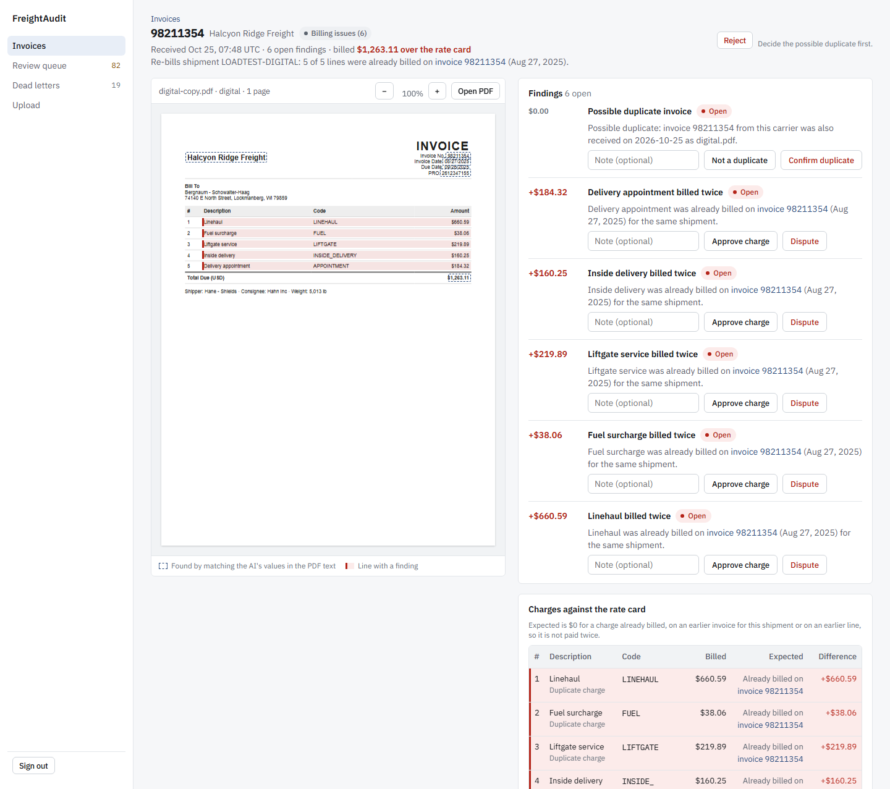

## Review UI

The web app (`apps/web`, Next.js) is where accounts-payable staff review invoices.

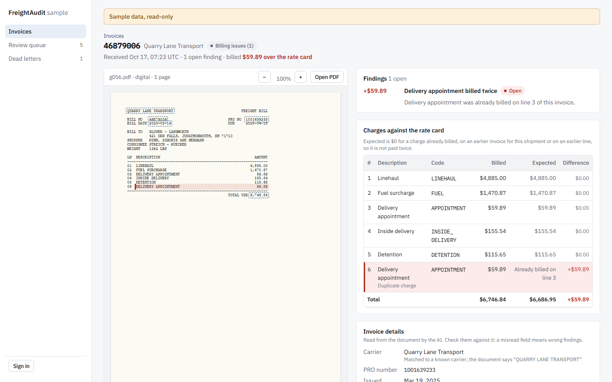
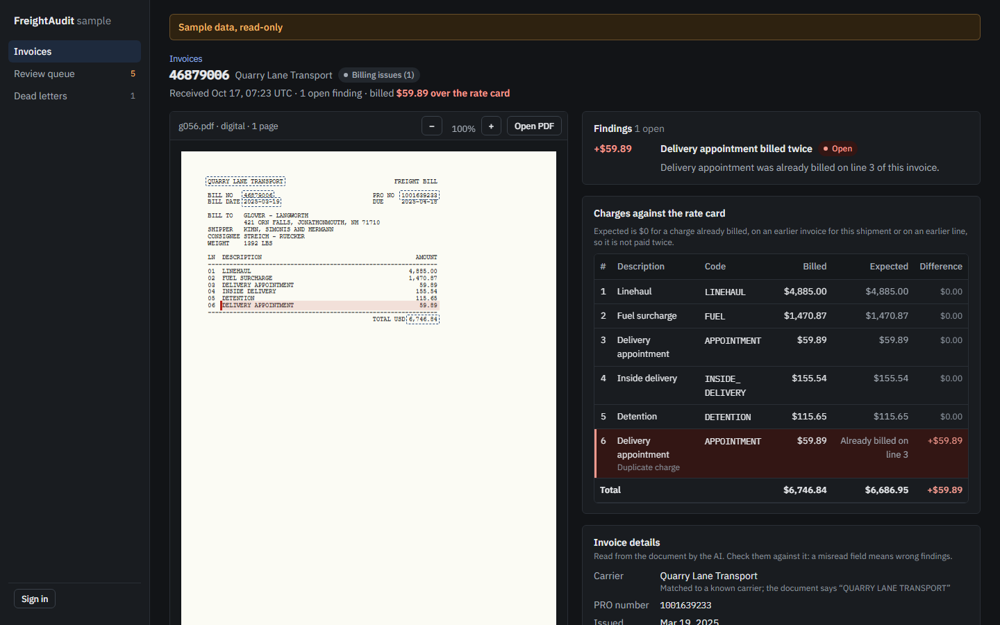

- **Pages:**
  - Landing page (`/`, public): the headline, how an invoice goes from upload to decision, the official eval results and the engineering behind them, with a sample invoice from `/demo` and links to the live demo and the sample (`apps/web/components/landing.tsx`).
  - Invoices: four cards (open findings, overbilling found, matched the rate card, still processing), a tab per state with its count (Reading needs a check, Billing issues, Ready to approve and the rest), a search by invoice number, PRO number or carrier, and each row's invoice, carrier and status, with the status's reason, what it billed, what the rate card allows and the difference. 25 a page, newest first, with Previous and Next (`apps/web/components/views.tsx`).
  - An invoice: the PDF beside the findings, the charges against the rate card, the invoice details and the audit trail in plain words. On a digital PDF, boxes mark the values the AI read where they appear exactly once in its text (`apps/web/lib/marks.ts`), and each line with a finding is tinted; a scan shows none, and says why. While every finding is open, three buttons decide them all at once (approve as billed, dispute, approve at rate card; `apps/web/components/detail.tsx`); each finding can also be decided alone. A charge billed twice says where it was billed first: on an earlier invoice for the same shipment, named with its printed date and linked, or on an earlier line; its Expected cell says the same, and an invoice that bills its shipment again says so under its title (`apps/web/lib/labels.ts`). It refreshes while the pipeline moves the invoice.
  - Review queue: approve a charge or dispute it, with an optional note.
  - Dead letters: replay a failed job.
  - Upload: chosen or dropped files are listed first, each with its first page, size and page count, and a warning for one the api would refuse (on the demo, any file outside the golden set). "Upload N invoices" sends them one at a time with its progress; a file that uploads leaves the list, and one that failed or was not sent stays with its reason. Toasts say what was uploaded, what failed (with Retry when the api was busy, at its rate limit or did not answer) and, once read, what waits for the reviewer (`apps/web/components/upload.tsx`). Recent uploads show their progress and result, and a re-bill names the invoice that billed its lines first. Three golden-set samples upload in one tap (`apps/web/public/samples/`).
- **Out of needs review:** correct the carrier or PRO number and re-run matching, reject the invoice with a reason (a final status), or approve it as billed, which runs the duplicate lookup first (see Duplicate invoices). The audit trail records every action with who, when and what changed, and every pipeline move, including how the carrier name matched, why a step failed and, while Claude reads first, why the free models read an invoice instead (`extractions.claude_handoff`).
- **Backend for frontend:** the browser talks only to the Next.js server, which calls the api with `API_KEY`; the key never reaches the browser. Every live page, route handler and action checks the session first; the landing page and the sample are public and never call the api.
- **Sign-in:** one reviewer, recorded as `reviewer` in the audit trail (`apps/web/lib/server.ts`). The password is checked against `DEMO_PASSWORD_HASH` (argon2id). The session cookie is httpOnly, Secure and SameSite=Lax and lasts 8 hours (`apps/web/lib/session.ts`). Five failed attempts in 15 minutes lock sign-in (`apps/web/lib/limiter.ts`); the count lives in each server instance's memory.
- **Threats and mitigations:** `docs/threat-notes.md`.

```bash
pnpm --filter @freightaudit/web hash-password --write-env  # asks for the password twice without echoing (docs/deploy.md); writes only DEMO_PASSWORD_HASH into .env
pnpm dev                                        # the UI on the web port in docs/context.md, Local ports
```

**Sample data.** `/demo` shows a frozen sample with no sign-in: 11 golden-set invoices (`apps/web/public/demo/invoices.json`), synthetic and read-only, served from `apps/web/public/demo/` without calling the api. The login page links to it. A signed-in user sees the same sample, under "Live backend offline, showing sample data", while the api's `/readyz` fails or `AI_ENABLED=false`. To regenerate it, with real model calls (the case ids are in `evals/golden/v1/manifest.json`):
1. `pnpm db:reset`, then start the api, worker and mock-tms with `AI_ENABLED=true`.
2. Upload golden v1 g054, g055, g056, g069, g002, g066, g081, g087 and g089. Clear the miles of g003's shipment in the dev database, then upload g003 too, so its reconcile fails into a dead letter. Upload g088 last and leave it: without a PRO number it stays in needs review.
3. Dispute one finding, approve one charge, approve an invoice, correct g087's PRO number, reject g089 with a reason.
4. `pnpm --filter @freightaudit/web demo:export --ids=<id>,<id>,...`. The export refuses any invoice whose file is not in the golden manifest, so a seeded or real invoice can never become public.
5. Rebuild the web (`pnpm build`, or its image): the pages read the sample when the web is built.

**End-to-end tests.** `pnpm e2e` builds every package the run needs (pipeline, api, worker and web, with their dependencies), starts this project's Postgres, Redis and MinIO with compose, and seeds its own database (`freightaudit_e2e`). Playwright then runs the recorded-fixture models, the api, the worker, the web and a second web whose api is down, all on loopback, on the ports in `docs/context.md` (Local ports). A taken port stops the run. The suite covers:
- the public landing page: no redirect, no api call and no key in it, each link, and the same page while the api is down;
- sign-in, its cookie and sign-out, and the sign-in lockout;
- uploads: files listed before anything is sent, then a PDF and a PNG read and checked, files refused in the browser, Remove and Clear, a batch's progress and toasts, Retry after no answer, the list at a phone's width, a sample tapped twice making one invoice;
- a re-bill naming the invoice that billed its charges first, on its upload row, in its header, findings and charges;
- deciding findings one by one and all at once, and the "changed" refusal;
- a possible duplicate from detection to rejection, and rejecting a checked invoice;
- the ways out of needs review: a corrected PRO number, a rejection, an approval as billed, and a hold for a possible duplicate, released or corrected;
- search and paging both ways, zoom, the not-found pages, and the public and offline sample with its marks.

CI runs it in the `e2e` job.

## Design

The UI was built from mockups that were drawn and approved before the build began: round 1 (the invoice list, an invoice and the upload page) and round 2 (the landing page and the dashboard, approved 2026-10-25). They are in `docs/design/mockups/`, in light, dark and on a phone. `pnpm e2e:screenshots` shoots the same screens at the mockups' sizes into `docs/screenshots/ui/round-1/` and `round-2/` (`apps/web/e2e/screenshots.spec.ts`), so the build can be held against them. Below, in light only, each approved mockup is on the left and the built screen on the right.

| Approved mockup | Built |
| --- | --- |
| 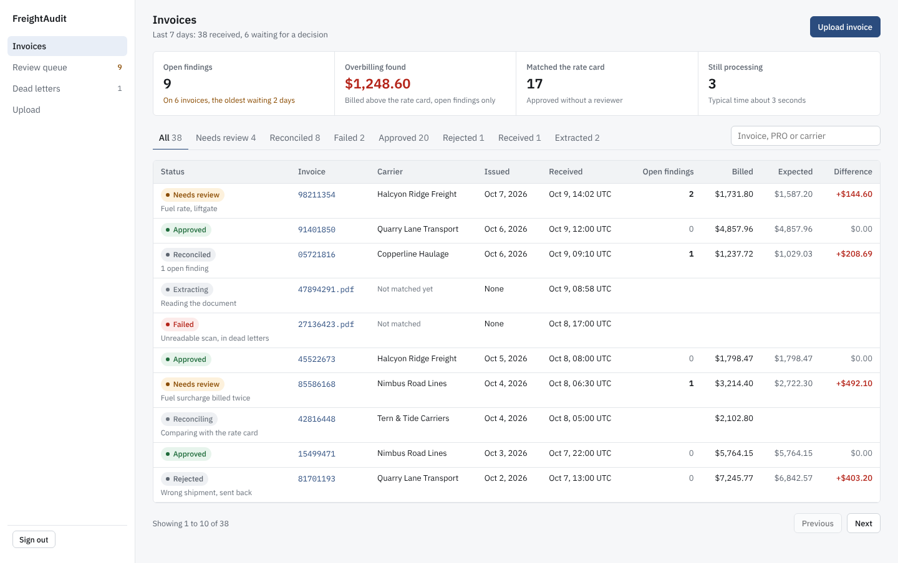 | 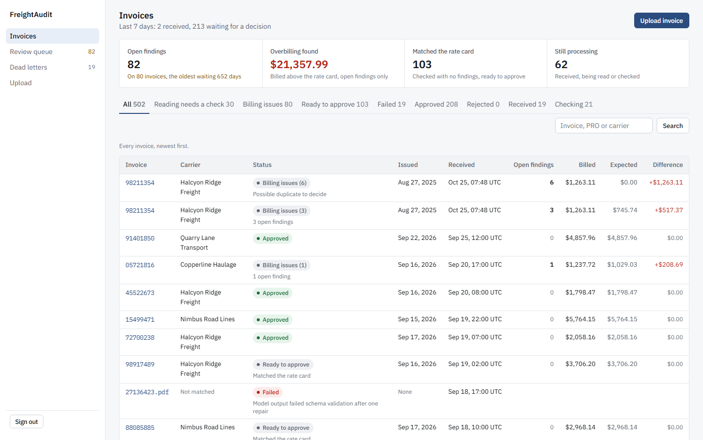 |
| 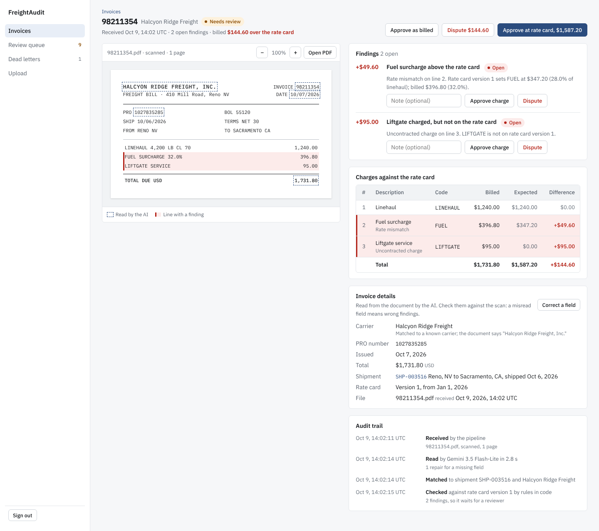 |  |
| 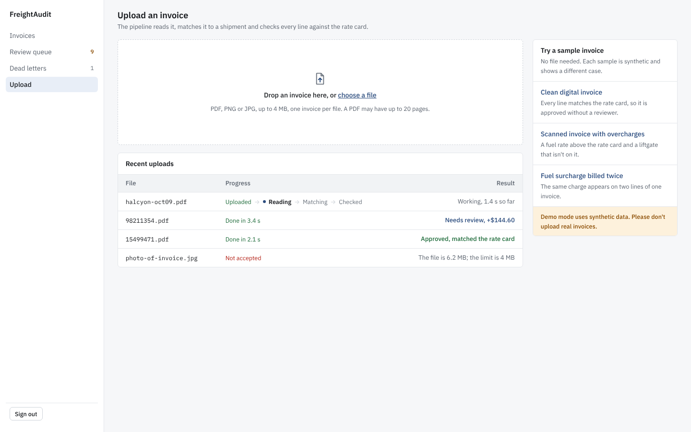 | 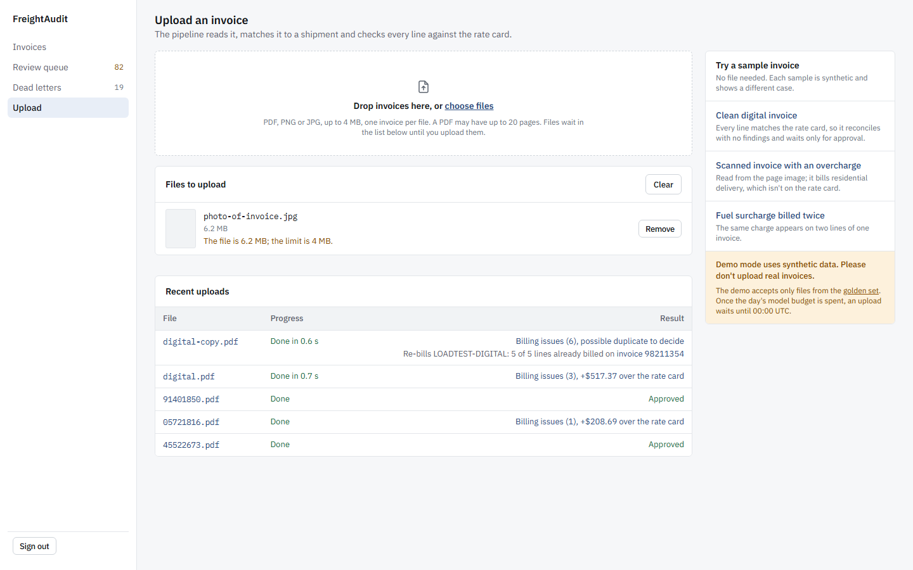 |
| 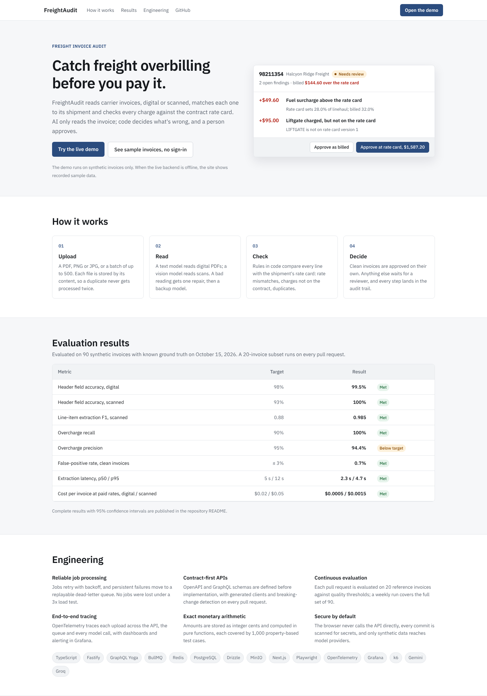 | 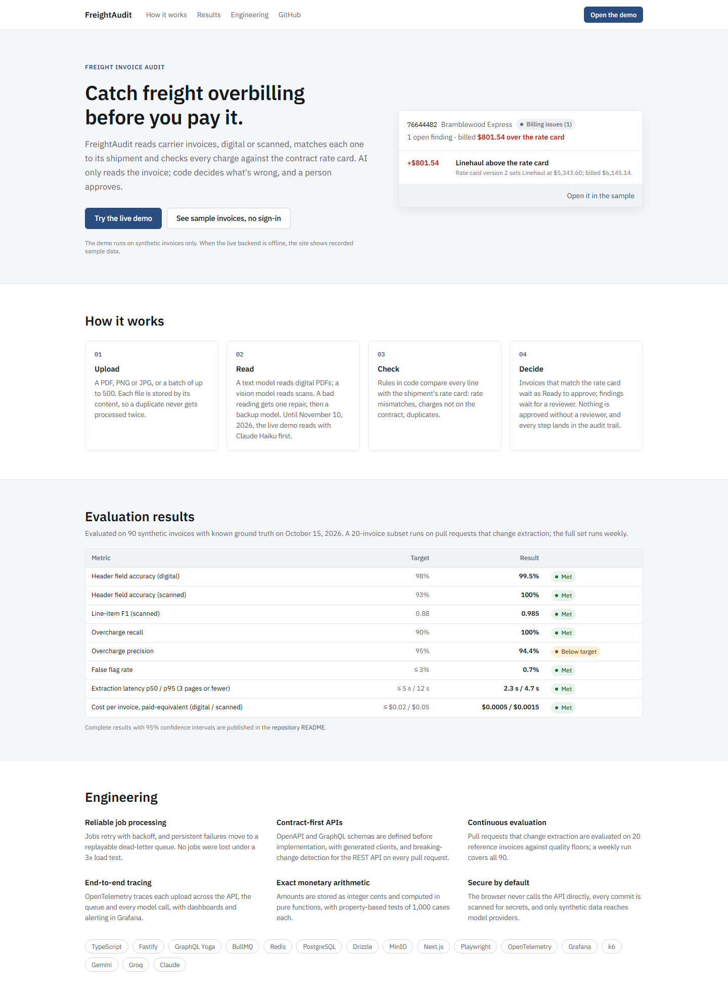 |

The data differ: the mockups show made-up invoices, and the built screens show the invoices the screenshot run seeds and uploads. The built landing page takes its results from the official eval report and its invoice from the sample, never the mockup's figures. Where the build departs from the mockups on purpose, `docs/memory.md` says why. For example, the mockups' "approved without a reviewer" texts were reworded, since nothing is approved without a reviewer.

The mockups were drawn with Claude (claude.ai) in a planning chat before the build.

## Setup

Requires Node 24 or later, pnpm 12 (both in `package.json`) and Docker.

```bash
pnpm install          # also sets git core.hooksPath to .githooks
cp .env.example .env  # then set API_KEYS; the comment above it shows how to generate a key
docker compose --env-file .env -f infra/docker-compose.yml up -d --wait
pnpm db:migrate
pnpm --filter @freightaudit/evals exec playwright install --only-shell chromium  # once, for pnpm fixtures and pnpm e2e
```

For the review UI also set `API_KEY` (one of `API_KEYS`), `SESSION_SECRET` (32 characters or more, `docs/deploy.md`) and `DEMO_PASSWORD_HASH` (see Review UI).

Add `--profile observability` to also start the OpenTelemetry Collector, Jaeger, Prometheus and Grafana. Stop infra with `docker compose -f infra/docker-compose.yml --profile observability down` (add `-v` to drop data).

Models run only with `AI_ENABLED=true` in `.env` (default false: no key needed, extract jobs wait). It then needs `GEMINI_API_KEY` (primary, reads scanned pages) and `GROQ_API_KEY` (text model and fallback), both free tiers; roles, models and per-minute limits are the `LLM_*` settings in `.env.example`. Free tiers may train on prompts, so send only synthetic invoices. Optional paid backup: `LLM_CLAUDE_MODEL=claude-haiku-5-5` with `ANTHROPIC_API_KEY` tries Claude Haiku 5.5 after a role's free model fails and before the free fallback. Empty (the default) keeps the free-only chain. With `LLM_CLAUDE_FIRST_UNTIL` set to a UTC date, Claude reads first until that day ends, under caps sized from its real use (`packages/llm/src/claude-first.ts`) and its own `DAILY_CLAUDE_TOKEN_BUDGET`. Out of credit, at a spend limit or with a bad key or model, Claude is switched off for every worker until `pnpm claude:resume`. CI never uses it; `pnpm eval --suite extraction --subset test --config claude-primary` runs it on this PC, beside the official free run, and sets no floors.

The api, worker and mock-tms validate their settings at startup and exit with a list of missing or invalid variables. The pre-commit hook blocks commits whose staged changes contain a secret; it runs a local `gitleaks` when installed, otherwise the pinned Docker image.

The public demo's backend runs on a personal PC as its own compose project, `freightaudit-prod`, started with `pnpm demo:up` from the settings in `.env.prod`; `docs/deploy.md` covers it (see Live demo).

## Usage

| Command | Purpose |
| --- | --- |
| `pnpm dev` | Run all apps in watch mode |
| `pnpm build` | Build every package and app |
| `pnpm typecheck`, `pnpm lint`, `pnpm test` | Checks (lint includes graphql-eslint). `pnpm test` runs the Jest `unit` project per package through Turborepo, cached: no infrastructure, and a guard fails any unit test that opens a socket or starts a process. `packages/domain` fails below 90 % coverage (`packages/domain/jest.config.js`) |
| `pnpm codegen` | Regenerate types and clients from `packages/contracts/openapi.yaml` and `schema.graphql` |
| `pnpm contracts:check` | Fail if committed generated code is stale (regenerates it) |
| `pnpm contracts:breaking` | Fail on breaking OpenAPI changes against `origin/main` (needs git, a fetched base branch and Docker; override the base with `OASDIFF_BASE_REF`) |
| `pnpm db:migrate [--to=<prefix>]` | Apply pending SQL migrations from `packages/db/migrations`; `--to` stops after the files with that prefix (see `docs/migrations.md`) |
| `pnpm db:seed --scale=small\|large` | Seed an empty, migrated database with deterministic demo data. Small is 1 tenant, 6 carriers, 5,000 shipments and 500 invoices; large is 50,000 shipments and 20,000 invoices (`docs/context.md`; the counts are `SCALES` in `packages/db/scripts/seed.ts`). Rate card versions carry per-mile bands, a minimum and a fuel percentage, shipments carry miles, and some invoices carry a planted overcharge, open on reconciled invoices and waiting for the reconcile job on extracted ones |
| `pnpm db:reset` | Dev only: empty this deployment's BullMQ queues at `REDIS_URL` (jobs and their ids, so a PDF uploaded before the reset is extracted again), drop every app table and its data in the database at `DATABASE_URL`, migrate from empty and seed `--scale=small`. It refuses before deleting anything unless Postgres and Redis are on a local host (`LOCAL_HOSTS` in `packages/db/scripts/reset.ts`) and `NODE_ENV` is not `production`; set `NODE_ENV=production` in `.env` on a machine whose data must survive. Stop the api and worker first. Stored PDFs stay |
| `pnpm test:int` | The Jest `integration` and `contract` projects in one root run (`jest.config.js`), against Postgres, Redis, MinIO and Toxiproxy containers that Testcontainers starts for the run on loopback and removes afterwards. Needs Docker, not the compose infra; each test uses a throwaway database, its own Redis key prefix and bucket. Covers migrations including expand, backfill and contract under the api's queries, the REST contract, keyset pagination under concurrent inserts, batch partial failure, rate limits and backpressure, the worker pipeline (retries, dead letters and replay, crash recovery, budget guard, multi-invoice split, TMS sync through 20 % connection resets and 300 ms latency, in `apps/worker/src/tms-chaos.int.test.ts`), reconciliation against the small seed's planted overcharges, and the fixture determinism test (needs the Playwright Chromium) |
| `pnpm fixtures [--count=60] [--seed=42]` | Render synthetic invoice PDFs from 6 templates (`evals/fixtures/templates.ts`), plus scanned variants, each with ground-truth JSON, into `evals/fixtures/out`; the defaults are in `evals/fixtures/generate-invoices.ts`, and the same seed gives byte-identical files on one machine. Each invoice bills a shipment the small seed leaves unbilled, so it reconciles against `pnpm db:seed --scale=small`; the ground truth gives each line's expected cents and every planted overcharge |
| `pnpm e2e` | The Playwright suite against the whole stack on this project's ports (see Review UI); needs Docker |
| `pnpm e2e:screenshots` | The invoice list, an invoice and the upload page at the sizes of the approved mockups, in light, dark and on a phone, into `docs/screenshots/ui/round-1/`; then every screen in light and dark, and three on a phone, into `docs/screenshots/ui/`. The sizes are in `apps/web/e2e/screenshots.spec.ts` |
| `pnpm demo:init`, `demo:up`, `demo:down`, `db:backup`, `db:reset-demo` | The public demo's backend on the demo PC: create `.env.prod`, start or stop project `freightaudit-prod`, dump its database to `backups/`, or reset it to the seed plus the sample invoices (`docs/deploy.md`) |
| `pnpm extract:resume` | Restart the extract queue after the worker paused it because a provider rejected its key or model (401, 403 or 404, in `packages/llm/src/errors.ts`; the worker logs `alert: "extract_paused"`). Fix the setting and restart the worker first |
| `pnpm eval --suite extraction --subset ci\|dev\|test\|full\|compare [--fresh] [--set-floors]` | Runs golden set v1 (`evals/golden/v1/manifest.json`: 90 invoices, a dev split of 20, a test split of 70 and a ci subset of 20) through the real worker against the small seed in throwaway Postgres and Redis containers, with the pinned roles from `.env` (real model calls; needs Docker and the keys). Each case's result is cached in `evals/.cache`, so a run stopped by a spent quota resumes; `--fresh` ignores the cache. Writes `evals/reports/<date>[-<subset>].json` and `.md` with every target met or missed and the regression floors of `evals/thresholds.json`; a full run rewrites the eval table above. The exit codes are in `docs/context.md`, Evals. `compare` runs `gemini-3.8-flash` beside the configured primary on `evals/comparison/v1`. Rebuild a set with `node evals/golden/build.ts --set golden\|comparison` only as a new version |

One project or file: `node --experimental-vm-modules node_modules/jest/bin/jest.js --selectProjects contract`, or `--selectProjects integration -- apps/worker/src/tms-chaos` (build the packages first with `pnpm build`).

Tests never call a real model provider: they replay responses recorded in `packages/llm/fixtures/recorded`. To re-record after changing a prompt or schema, run the affected integration tests with `LLM_RECORD=1` (keys come from `.env`); `LLM_PROVIDER=ollama` sends the recorded tests' requests to a local Ollama instead (`OLLAMA_BASE_URL`, `OLLAMA_MODEL`).

Apps (each answers `GET /healthz` and `GET /readyz`, bound to loopback; ports from `docs/context.md`, Local ports): web `:3000` (the review UI), api `:4000` (GraphQL at `/graphql`), worker `:4001`, mock-tms `:4010`. Every api route except the two probes requires the `X-API-Key` header and is rate limited per key (by default 60 requests and 10 uploads a minute: `RATE_LIMIT_PER_MIN` and `UPLOAD_RATE_LIMIT_PER_MIN` in `.env.example`); everyone using the review UI shares its one key's limits. An upload is a PDF, PNG or JPG of at most 4 MiB, and a PDF has at most 20 pages (`packages/contracts/src/limits.ts`); an image is stored as a one-page PDF of it (`packages/llm/src/pdf.ts`), and the same image always gives the same PDF, so duplicate uploads are still caught. Uploads go to MinIO and the `extract` queue; the worker extracts only when `AI_ENABLED=true` (a document of text pages to the text model, any other to the primary, one repair, then the fallback, then needs_review; `packages/llm/src/extract.ts`), records every model call in `llm_calls`, and otherwise holds extract jobs back. Node services log JSON lines (pino) with a request id, at `LOG_LEVEL`, with credentials redacted.

Infra (bound to loopback; host ports set in `.env`, defaults in `.env.example`): Postgres `:5432`, Redis `:6379`, MinIO `:9000` (console `:9001`), Toxiproxy API `:8474` with proxies postgres `:15432`, redis `:16379`, mock-tms `:14010`. With `--profile observability`: OTLP `:4317`/`:4318`, Jaeger UI `:16686`, Prometheus `:9090`, Grafana `:3001`.

## Observability

Start the monitoring stack with `docker compose --env-file .env -f infra/docker-compose.yml --profile observability up -d --wait`.
- **How it starts:** the api and worker load OpenTelemetry through `node --import ./src/telemetry.ts` (their dev scripts and Docker images do this). They send traces and metrics as OTLP/JSON to the collector at `OTEL_EXPORTER_OTLP_ENDPOINT`.
- **Where data goes:** the collector passes traces to Jaeger and exposes metrics for Prometheus. Grafana (admin/admin on a fresh volume) opens the provisioned **FreightAudit** dashboard. Their ports are the Infra line above.
- **Turning it off:** without the profile, exports fail quietly. `OTEL_SDK_DISABLED=true` skips the SDK.

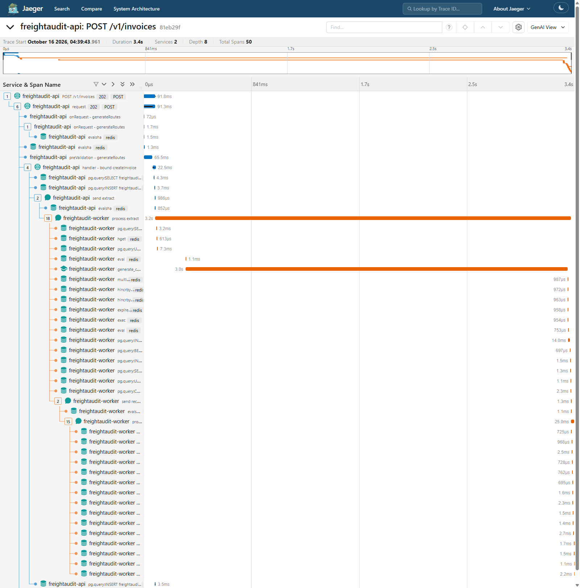

**Traces.** One upload is one trace, from the api's `POST /v1/invoices` through the worker's extract, each model call and reconcile.
- The trace crosses BullMQ as a W3C `traceparent` in job data (`data.otel`). A producer span wraps each add, and a consumer span wraps each job attempt.
- A multi-invoice upload's parts are children of the span that added their flow.
- Auto-instrumentation covers http, Fastify, pg and ioredis:
  - SQL is recorded with `$n` placeholders.
  - Redis spans name the command only, since BullMQ passes job data as script arguments.
  - Health probes are left out.
- Model calls follow the OpenTelemetry GenAI semantic conventions. Those conventions are still in development, so the attribute names are pinned to **semconv v1.41.1**, the last core release that defines them (v1.42.0 moved them to the separate GenAI conventions repository; both in `packages/llm/src/trace.ts`). The names are inlined there, and the tracers declare schema URL 1.41.1.
- Each model call is `generate_content <model>` (Gemini) or `chat <model>`. It records the provider, request and response model, input and output tokens, finish reason, role and ladder step.
- Spans and logs never carry PDF text, line items or keys. `apps/worker/src/telemetry.int.test.ts` runs the real processes and fails on a forbidden attribute key, or on a planted canary in any exported span or log line.

**Metrics** (`packages/telemetry/src/metrics.ts`):
- queue depth per queue and state, and dead letters waiting
- job duration and wait (histograms), and retries by error class
- model tokens, paid-equivalent cost (paid prices from `packages/llm/prices.json`, even on free tiers) and provider 429s
- extraction escalations and fallbacks, the extract circuit breaker, needs_review by reason, and intake 503s

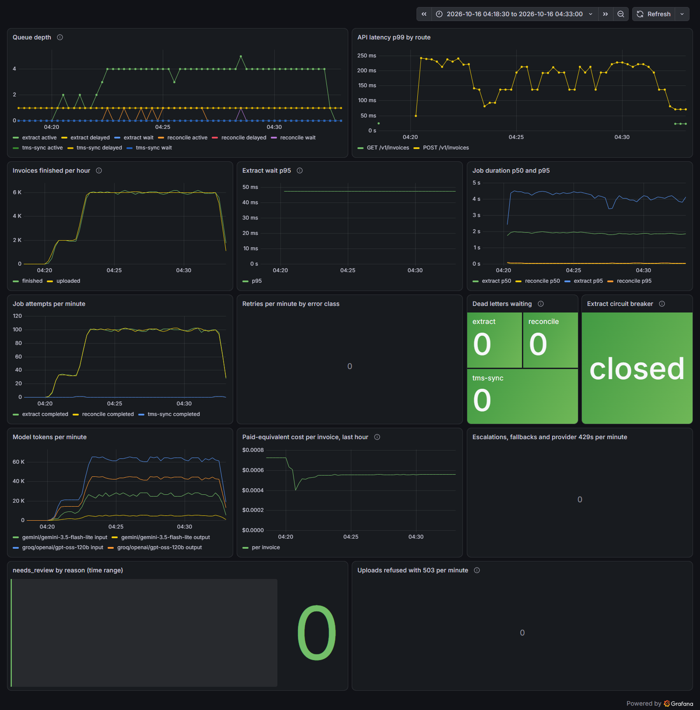

**Alerts** (`infra/prometheus-alerts.yml`, evaluated by Prometheus and listed in Grafana's Alerting page):
- dead letters waiting for 10 minutes
- extract wait p95 above 60 s for 5 minutes
- paid-equivalent cost per invoice above $0.05 over the last hour
- the circuit breaker open

`docker run --rm -v "$PWD/infra:/infra:ro" --entrypoint promtool prom/prometheus:v3.15.0-busybox test rules /infra/prometheus-alerts.test.yml` checks that each rule fires and stays quiet at the right times; CI runs it with the same image, pinned by digest in `.github/workflows/ci.yml`.

## Load test

Two k6 runs (`loadtest/k6.js`, run by the compose service `k6` from the pinned `grafana/k6` image) measure different things. Each writes `loadtest/<scenario>-results.json`, and those files fill the last two rows of the eval table.

Run k6 from PowerShell. Git Bash rewrites `/loadtest/k6.js` into a Windows path unless `MSYS_NO_PATHCONV=1` is set.

### Part 1: system load on the recorded-fixture model provider

This part does not use real models. Its rates and mix are in `loadtest/k6.js`.
- **Load:** the normal rate is the design's throughput target, 2,000 invoices an hour. The run sends 2 minutes at 2,000/h, then 10 minutes at 6,000/h (3x), to 2 workers (`docs/activity-log.md`, 2026-10-16, Step 8) at concurrency 8 (`EXTRACT_CONCURRENCY` in `.env.example`; the design's 2 workers x concurrency 8 is in `docs/context.md`, Targets).
- **Model calls:** `pnpm --filter @freightaudit/llm fixture-models` answers every call with the real Groq or Gemini response recorded for `packages/llm/fixtures/{digital,scanned}.pdf`, after 2,300 ms (`packages/llm/scripts/fixture-models.ts`), near the eval's measured extraction p50 of 2,333 ms (`evals/reports/2026-10-15.md`).
- **Uploads:** byte-variants of those two PDFs, 4 digital to 1 scanned.

**Result (2026-10-15, `loadtest/system-results.json`):**
- 1,083 uploads: all accepted, all reconciled, none lost or refused.
- Upload latency p50 30 ms, p95 86 ms, p99 155 ms.
- Through the 3x phase the extract queue held about 4 active jobs and none waiting, so its depth stayed flat (dashboard above; `docs/activity-log.md`, 2026-10-16, Step 8).
- What this shows is spare capacity, not backpressure: the queue never got near its high-water mark (`EXTRACT_HIGH_WATER`, 5,000 waiting jobs in `.env.example`), so the api never answered "busy, try later". The proof of that path is in `apps/api/src/limits.int.test.ts`: uploads get 503 with `Retry-After: 30` while the backlog is above the mark, and the 11th upload in a minute gets 429.
- Every invoice was final within 5 s of the last upload: the drain starts 5 s after it (`loadtest/k6.js`) and found none pending (`drain_s: 0`).

The ports in the commands below are in `docs/context.md`, Local ports.

```powershell
pnpm db:reset
Get-Content loadtest/fixture-shipments.sql -Raw | docker exec -i freightaudit-postgres-1 psql -U freightaudit -d freightaudit
pnpm --filter @freightaudit/llm fixture-models   # :4011
# In apps/api, then twice in apps/worker (the second with $env:WORKER_PORT=4002), each in its own terminal:
node --env-file=../../.env --env-file=../../loadtest/system.env --import ./src/telemetry.ts src/main.ts
docker compose --env-file .env -f infra/docker-compose.yml run --rm k6 run -e SCENARIO=system /loadtest/k6.js
```

### Part 2: end-to-end latency at low load with real free-tier models

- **Cases:** 20 single-page golden v1 invoices, 10 digital and 10 scanned (`loadtest/k6.js`).
- **Pace:** one every 15 s, below the free tiers' ceiling of about 394 an hour (`evals/reports/2026-10-15.md`), so the run measures latency, not throttling. The worker logged no 429 (`docs/activity-log.md`, 2026-10-16, Step 8).
- **Timing:** each invoice is timed from its upload request to its final status.

**Result (2026-10-15, `loadtest/e2e-results.json`):**
- All 20 reconciled.
- p50 3,108 ms, p90 4,162 ms, max 4,663 ms. n = 20 gives no meaningful p95, but even the max is under the 30 s target (`docs/context.md`, targets).

```powershell
# In apps/api: the api, with rate limits raised for k6's 500 ms polls (loadtest/k6.js, loadtest/e2e.env).
node --env-file=../../.env --env-file=../../loadtest/e2e.env --import ./src/telemetry.ts src/main.ts
$env:AI_ENABLED='true'; pnpm --filter @freightaudit/worker dev   # the real models from .env
pnpm --filter @freightaudit/mock-tms dev
docker compose --env-file .env -f infra/docker-compose.yml run --rm k6 run -e SCENARIO=e2e /loadtest/k6.js
```

## CI/CD

GitHub Actions, with every action pinned to a commit SHA, every tool image to a digest, and per-job token permissions.

- `ci.yml` (pull requests, and the checks of `release.yml`): lint and typecheck (plus actionlint and the promtool alert rule tests), unit tests (`pnpm test --force`, so a cached pass never counts), integration tests (Testcontainers and the Playwright Chromium), end-to-end tests (`pnpm e2e`, the Playwright report kept on failure), contracts (`contracts:check` and oasdiff against the base), migrations (all of them on a fresh database, and this change's on a seeded snapshot built from the base, which must end in the same schema), golden set checksums, the eval smoke (`pnpm eval --suite extraction --subset ci` on same-repository PRs, report posted as a PR comment; a broken floor fails, a quota stop only warns), a Docker build and Trivy scan per image, gitleaks and `pnpm audit`.
- `release.yml` (push to main, or by hand from main for a push that started none): the same checks, then `ghcr.io/<owner>/freightaudit-{api,worker,web}` tagged `sha-<short>` and `latest` with provenance. Nothing deploys from CI: the PC pulls these images (`pnpm demo:up`), and Vercel builds the UI from main.
- `nightly-eval.yml`: the full eval weekly (its `cron`: Mondays 03:23 UTC) or on demand, report as an artifact, an issue when a floor breaks; re-running that workflow run resumes from its cached cases.

Repository secrets: `GEMINI_API_KEY` and `GROQ_API_KEY`; optionally `TURBO_TOKEN` with the variable `TURBO_TEAM` for Turborepo Remote Cache. Images build from the repository root: `docker build -f apps/api/Dockerfile .` (or `apps/worker`, `apps/web`).

See `docs/context.md` for the design and `docs/todo.md` for the build plan.
